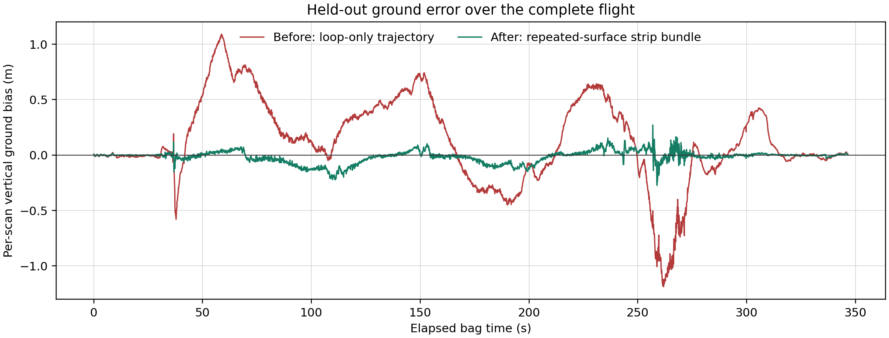
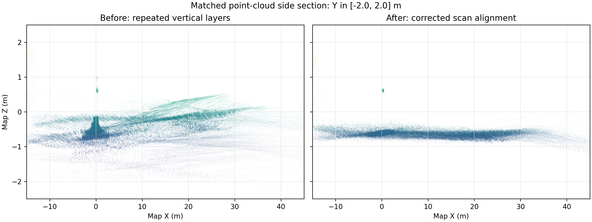

# Diagnostic Study of Bag-Only UAV LiDAR Map De-Layering

## Abstract

This study diagnoses and corrects the layered ground surfaces in the UAV LiDAR map
recorded in `recovered_bag`. The investigation separated single-scan precision from
trajectory drift, tested deskewing, scan registration, GNSS scaling, loop closure and
surfel fusion, and reserved the Bayern point cloud for held-out evaluation. The
decisive correction was a robust repeated-surface vertical bundle adjustment using
only bag data. Across all 3,436 scans, held-out vertical-bias RMSE decreased from
`0.4036 m` to `0.0583 m` (85.6%), NMAD from `0.3452 m` to `0.0313 m` (90.9%), and
P95 absolute error from `0.8158 m` to `0.1271 m` (84.4%).

## Experimental Separation

**Estimation inputs:** LiDAR points and firing times, recorded body odometry, raw
GNSS altitude, static LiDAR-body transform, and the LiDAR start/end loop closure.

**Held-out evaluation only:** Bayern ground point cloud. It did not supply scan
offsets, trajectory corrections, surface heights, or registration constraints.
Horizontal evaluation alignment used onboard GNSS; Bayern supplied only ground-height
residuals after the bag-only trajectory was frozen.

## Diagnostic Procedure and Evidence

| Step | Test and observation | Decision |
|---|---|---|
| 1. Inspect the raw evidence | 3,436 VLP-16 scans at 9.91 Hz contained ring IDs and approximately 100 ms point-time spans. Odometry was 21 Hz and IMU only 35 Hz. | Point-level deskew was possible; rotor-frequency vibration could not be proven above the IMU's 17.5 Hz Nyquist limit. |
| 2. Expose the error without display voxels | Direct-point rendering showed horizontally coherent but vertically separated surface copies. Large occupancy voxels only hid the separation. | Diagnose the trajectory before any smoothing. |
| 3. Test the grounded control interval | First 100 grounded scans had median plane RMSE `0.0116 m`, plane-offset span `0.0410 m`, and normal span `0.109 deg`. | Raw LiDAR precision and the static transform were locally consistent; metre-scale layers developed during flight. |
| 4. Apply per-point deskew | Deskew moved matched points by `0.052 m` median and `0.597 m` at P95. The repeated-column proxy changed from `0.796 m` to `0.802 m`. | Necessary motion compensation, but not the solution to accumulated trajectory-height error. |
| 5. Audit scan registration | Initial unconstrained KISS-ICP accumulated `15.65 m` during a grounded 10 s interval versus `0.267 m` onboard motion. A shared NaN mask fixed point/timestamp mispairing. Flat ground still left vertical registration weakly observable. | Keep odometry priors and innovation gates; reject unrestricted ICP as a reliable vertical estimator. |
| 6. Test the altitude hypothesis | Held-out bias correlated `0.728` with onboard altitude and reached approximately `1.44 m`. Raw GNSS relative altitude implied a bag-only vertical scale of `0.94036`. | Correct odometry vertical scale from the independent onboard raw-GNSS stream. |
| 7. Measure loop closure | Aggregated grounded start/end LiDAR scans gave an endpoint correction of approximately `0.417 m` vertically with about `1.2 deg` rotation. | Distribute the endpoint correction globally, but do not expect one loop factor to correct intermediate drift. |
| 8. Optimize repeated surfaces | A robust sparse bundle used 3,141,850 low-surface observations from 45,991 cells seen in at least four scans. It jointly estimated terrain heights and one vertical offset per scan, with temporal smoothness and first/last 100-scan anchors. | This was the decisive de-layering stage. Estimated scan offsets ranged from `-1.053 m` to `+1.136 m`; P95 magnitude was `0.808 m`. |
| 9. Reconstruct and fuse | All scans were reconstructed with per-point pose interpolation. Only afterward were repeated observations fused in 10 cm cells with a minimum support of two. | Preserve the 8,006,176-point reconstruction as master data; use the 948,195-surfel product for smooth inspection. |

## Attempts That Did Not Solve the Problem

- **Large occupancy voxels:** made layers less visible but removed box/person detail;
  no trajectory error was corrected.
- **Deskew alone:** corrected intra-scan motion but left inter-scan altitude drift.
- **Unconstrained flat-ground ICP:** diverged during the grounded control interval.
- **Conservative odometry-seeded KISS-ICP:** stabilized registration but its complete
  map had a `0.829 m` repeated-column proxy, worse than the `0.796 m` control. This
  proxy includes real vertical objects, so it is diagnostic rather than absolute.
- **Loop closure alone:** fixed the endpoint but retained intermediate vertical-bias
  RMSE of `0.4036 m`.
- **20 cm surfel fusion:** produced a cleaner display but merged layers and could
  suppress small objects. Fusion cannot repair a wrong trajectory.
- **Bayern-assisted per-scan correction:** previously reached `0.127 m` ground RMSE,
  but it used the reference during correction and therefore was not accepted as a
  self-contained onboard mapping solution.

## Quantitative Results

| Metric | Loop-only map | Final strip-optimized map | Improvement |
|---|---:|---:|---:|
| Evaluated scans | 3,436 | 3,436 | same data |
| Vertical-bias RMSE | 0.4036 m | **0.0583 m** | **85.6% lower** |
| Vertical-bias NMAD | 0.3452 m | **0.0313 m** | **90.9% lower** |
| P95 absolute vertical bias | 0.8158 m | **0.1271 m** | **84.4% lower** |
| Median vertical bias | 0.0604 m | **-0.0040 m** | near-zero bias |
| Median within-scan ground NMAD | 0.0951 m | 0.0951 m | unchanged, as expected |
| Onboard-GNSS horizontal fit RMSE | 0.0295 m | 0.0295 m | same registration |

The unchanged within-scan NMAD is important: the optimizer removed scan-to-scan
height drift without artificially shrinking each scan or filtering points against
the Bayern surface. The synthetic bundle test recovered a known injected drift with
`0.0055 m` offset RMSE and `0.0073 m` residual RMSE.



*Figure 1. Scan-indexed Bayern ground residual after freezing each trajectory. The
reference scores both trajectories but does not optimize either one.*



*Figure 2. Identical side section, point stride, axes and color limits for both direct
reconstructions. The left panel exposes metre-scale repeated ground layers; the right
panel shows their collapse into one continuous surface. Sparse elevated structures
remain because this is the direct map, not the filtered surfel product.*

## Final Artifacts and Interpretation

- `pcds/bag_only_strip_optimized_reconstructed.pcd`: master direct-point map,
  8,006,176 points; preserves sparse and transient objects.
- `pcds/bag_only_strip_optimized_surfels_10cm_min2.pcd`: recommended smooth static
  inspection map, 948,195 surfels; median support four and P95 support 20.
- Surfel normal-direction standard deviation: `0.0161 m` median and `0.0241 m` P95.
  These are within-cell repeatability statistics, not absolute map accuracy.

The evidence supports a reliable decimetre-class relative surface map for this bag.
It does not support survey-grade absolute accuracy. Remaining approximately `0.095 m`
within-scan ground spread may include beam noise, vegetation, correspondence error,
residual roll/pitch error, and LiDAR-body calibration error. Correcting that safely
requires higher-rate inertial evidence or surveyed calibration; stronger voxel
filtering would improve appearance while weakening the scientific result.

## Reproduction

Generate both figures from the saved maps and evaluation CSV files:

```bash
/home/gvb/Documents/robotspace/venvs/ddlzd_mapping/bin/python \
  scripts/bag_lio_mapping/generate_diagnostic_figures.py
```

The complete mapping and held-out evaluation commands are documented in
`scripts/bag_lio_mapping/README.md`.
